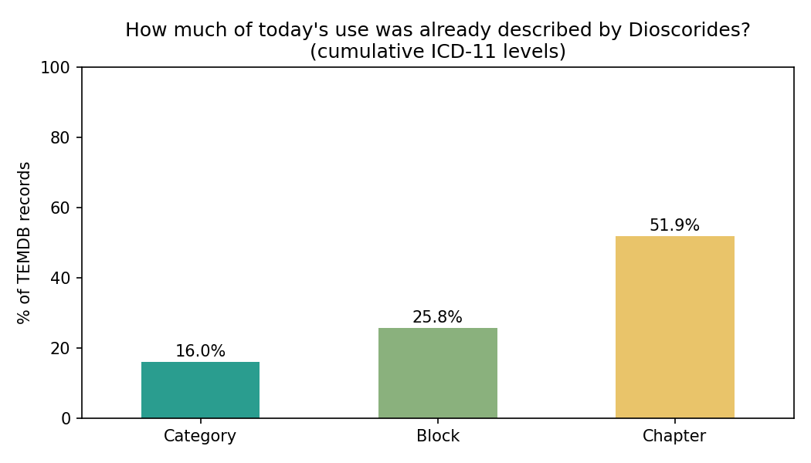
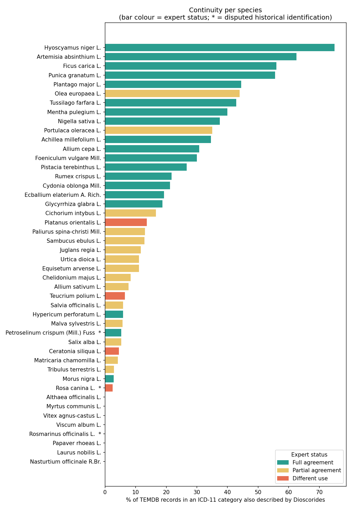

# EthnoAnatolia Cross-Ref

> **EthnoHack 2026 — Track 1: Traditional knowledge — NLP & AI on historical and ethnobotanical texts**
> Team: botanists · Members: Fatıma Beyhan Kartal, Onur Tuncay, Miraç Ekici

> ⚠️ **Disclaimer:** This project works with *historical and traditional claims* about plants.
> Extracted passages describe what historical or traditional sources say. They do **not** establish
> efficacy or safety and are **not medical advice**. Do not prepare or ingest any remedy based on this tool.

---

## 1. Project Description

### The chosen challenge
Track 1 — Traditional knowledge: NLP & AI on historical and ethnobotanical texts.

### The problem being solved
In ethnobotanical studies, the literature is scattered and not standardised, so researchers lose a
significant amount of time searching through every source one by one. Cross-referencing the data in
TEMDB with *De materia medica* by Dioscorides — a foundational work of pharmacy and botany — gives a
comprehensive picture of how the use of medicinal plants in Anatolia has evolved from antiquity to the
present and how it has maintained continuity. This is of great importance to us as pharmacists.

### Our solution
A standardised, common dataset that accelerates research, reduces fragmentation in the literature and
allows ancient and modern data to be compared from a single source.

- **Extraction from *De materia medica*:** preparation methods and medicinal uses of Anatolian plants were
  extracted from Dioscorides' *De materia medica* (46 species, 606 use records). Uses were taken from the
  public-domain Sprengel 1829 Latin edition [1] and checked against the Wellmann Greek edition [2]
  (vol. 2; used for verification only, not redistributed).
- **Species selection:** only species recorded **both** in *De materia medica* and in TEMDB were included.
- **ICD-11 coding:** each Dioscorides use was assigned an ICD-11 MMS code using the WHO ICD-11 MMS
  reference document, following the same coding conventions as TEMDB so that the two datasets are
  comparable. *(The ICD-11 coding of TEMDB itself is pre-existing — see Section 2. The coding of the
  Dioscorides uses is new work.)*
- **Cross-referencing with TEMDB:** each historical use was matched to TEMDB records for the same species
  (plant part, preparation and ICD-11 category).
- **Continuity analysis:** for each species and disease category we assessed whether a use described in
  antiquity persists in present-day Anatolian folk medicine, i.e. continuity from antiquity to today.

### Role of the LLM in the pipeline

> *Clarification added on 10 November 2026 in response to feedback; the analysis and results are unchanged.*

A large language model (**Claude, Anthropic**, used interactively through Claude Code) was a core part of
the pipeline, not just a writing aid:

| Step | Done by | Details |
|---|---|---|
| 1. Text access | Internet Archive OCR | Digitised Sprengel 1829 (Latin) and Wellmann 1906 (Greek) editions |
| 2. Use extraction | **LLM** | The LLM read the OCR text and extracted each medicinal use into a structured row (species, plant part, preparation, indication) |
| 3. ICD-11 mapping | **LLM** | The LLM assigned an ICD-11 MMS code to each extracted use, using the WHO ICD-11 MMS reference document and the TEMDB coding conventions given to it (e.g. therapeutic effects → unclassified; burns NE2Z; wounds ND56.1; bites NE61) |
| 4. Cross-referencing & continuity metrics | Python code (no LLM) | Deterministic, re-run in the notebook (`src/ethnoanatolia_crossref.ipynb`) |
| Guidance | Project lead | Wrote the prompts, chose the sources and set the ICD-11 coding conventions (from TEMDB) |

**Validation status:** the LLM extractions and ICD-11 codes have **not yet been independently verified by hand**
against the source text. The continuity percentages should therefore be read as a first, LLM-assisted estimate.
Planned next step: manual double-coding of a random sample by two TEMDB curators and reporting the
LLM–expert agreement (precision/recall for extraction, Cohen's κ for ICD-11 codes).

The LLM was used through a chat interface, not via an API, so no LLM code or API key is part of this repository;
the extracted, coded data are shipped in `data/Dioscorides_TEMDB_Continuity.xlsx`.

## 2. Pre-existing work (disclosure)

**TEMDB — Turkish Ethnomedicinal Database** (the dataset we published as a team) · Published 27 August 2026 ·
DOI: [10.5281/zenodo.20002971](https://doi.org/10.5281/zenodo.20002971) · Licence: Creative Commons
Attribution 4.0 International (CC BY 4.0).

TEMDB was used only as a reference and remained unchanged throughout the event. The TEMDB ICD-11
harmonisation and indication coding were completed before the event and were used only as input.

Full details: [`docs/DISCLOSURE.md`](docs/DISCLOSURE.md). Everything else in this repository was created
during the hackathon (2–8 November 2026); see the commit history.

## 3. Technologies

| Category | Used |
|---|---|
| Programming languages | Python 3 (Jupyter notebook, runs in Google Colab) |
| Libraries | pandas, openpyxl, matplotlib |
| Data sources | Dioscorides, *De materia medica* (Sprengel 1829; Wellmann 1906), TEMDB ([Zenodo](https://doi.org/10.5281/zenodo.20002971)) — see [`data/SOURCES.md`](data/SOURCES.md) |
| Text access | Internet Archive digitised editions and OCR text |
| Disease classification | WHO ICD-11 MMS (reference document) |
| Data processing & analysis | Microsoft Excel |
| LLM (core pipeline) | Claude (Anthropic), via Claude Code — **use extraction** from the OCR text and **ICD-11 mapping** of each use; also data structuring and drafting. Not yet independently verified by hand (see [Role of the LLM](#role-of-the-llm-in-the-pipeline)) |

## 4. Installation

**No installation is needed.** The analysis runs in Google Colab in the browser; only a Google account is required.

[](https://colab.research.google.com/github/fatimabeyhan0332/makeathon-2026-botanists-traditional-knowledge/blob/main/src/ethnoanatolia_crossref.ipynb)

*Optional — run locally instead of Colab (requires Python 3.10+ and Jupyter):*

```bash
git clone https://github.com/fatimabeyhan0332/makeathon-2026-botanists-traditional-knowledge.git
cd makeathon-2026-botanists-traditional-knowledge
pip install -r requirements.txt
jupyter notebook src/ethnoanatolia_crossref.ipynb
```

## 5. How to run

1. Click the **Open in Colab** button above.
2. In Colab, choose **Runtime → Run all**.
3. The notebook automatically downloads its input,
   [`data/Dioscorides_TEMDB_Continuity.xlsx`](data/Dioscorides_TEMDB_Continuity.xlsx), from this repository,
   so no files need to be uploaded.
4. Results are shown in the notebook and downloaded as a zip file (`ethnoanatolia_outputs.zip`).

| Input | Output |
|---|---|
| Dioscorides use records (46 species, 606 uses, ICD-11 coded) cross-referenced with TEMDB (1,229 records for the same species) | `EthnoAnatolia_results.xlsx` (all results in one formatted workbook), `species_continuity_metrics.csv`, `crossref_shared_categories.csv`, `overall_continuity.csv` and charts (PNG) |

**What the notebook does:** data-quality checks → re-computes the continuity metrics from the category-level data
and checks them against the stored values (reproducibility check) → compares the expert continuity status with an
objective threshold-based class → builds the cross-reference table of **shared** ICD-11 categories.

## 6. API key management

This repository contains **no API keys**. Keys are read from a local `.env` file that is excluded by `.gitignore`.

1. Copy the template: `cp .env.example .env` (Windows: `copy .env.example .env`)
2. Get the keys you need:

| Service | Where to create the key | Variable in `.env` |
|---|---|---|
| WHO ICD-11 API | Register at https://icd.who.int/icdapi → "View API access key(s)" | `ICD_CLIENT_ID`, `ICD_CLIENT_SECRET` |
| LLM | Not needed — the LLM was used interactively (chat), not via an API; its output is already in `data/` | — |

3. Paste the values into `.env`. The application loads them at start-up (e.g. with `python-dotenv`).

The hackathon-hosted APIs (`*.ethcstwin.di.uoa.gr:65000`) need no key.

## 7. Results and presentation

### Key results (46 species · 1,229 TEMDB records · 588 Dioscorides therapeutic uses)

| Continuity measure | Value |
|---|---|
| TEMDB records whose ICD-11 **category** was already described by Dioscorides | **16.0 %** |
| ... at ICD-11 **block** level | **25.8 %** |
| ... at ICD-11 **chapter** level | **51.9 %** |
| Dioscorides uses still found in present-day TEMDB | **19.9 %** |

Highest continuity: *Hyoscyamus niger* (75 %), *Artemisia absinthium* (62.5 %), *Ficus carica* (56 %),
*Punica granatum* (55.6 %). 95 plant × ICD-11 category pairs are shared between the two sources
([`outputs/crossref_shared_categories.csv`](outputs/crossref_shared_categories.csv)).





All result files are in [`outputs/`](outputs/) and are regenerated by the notebook.

- Demo video: [YouTube (2:44, no audio)](https://youtu.be/baJch1sK8lA)
- Slides: [EthnoAnatolia_CrossRef_slides.pdf](docs/EthnoAnatolia_CrossRef_slides.pdf)

## 8. Data, rights and responsible use

- Every source is listed with its licence, URL and retrieval date in [`data/SOURCES.md`](data/SOURCES.md).
- Only public-domain or openly licensed texts are redistributed. Texts with unclear rights are cited, not copied.
- Historical names may map to zero, one or several modern taxa; the tool records the evidence for each candidate.

### Scope and limitations
- Only species recorded **both** in Dioscorides' *De materia medica* and in TEMDB are included (46 species).
- TEMDB currently covers a three-year period of Turkish ethnobotanical literature (2018–2020). A use that is
  absent from TEMDB is therefore **not** evidence that it has disappeared from Anatolian folk medicine;
  it may simply be outside the current coverage.
- TEMDB is being extended by our team as ongoing academic work outside this hackathon; the continuity
  analysis can be re-run as new TEMDB versions are released.

## 9. Repository structure

```
├── data/          # small input files + SOURCES.md (large files: external links)
├── docs/          # DISCLOSURE.md, screenshots
├── outputs/       # generated results
├── src/           # source code
├── .env.example   # template for API keys (copy to .env)
├── .gitignore
├── requirements.txt
└── README.md
```

## 10. Team

| Name | Role |
|---|---|
| Fatıma Beyhan Kartal | **Project lead** — extraction of uses from *De materia medica*, ICD-11 coding, TEMDB cross-referencing, continuity analysis, repository and documentation |
| Assist. Prof. Onur Tuncay | **Scientific supervisor** — co-author of TEMDB (the reference dataset); scientific guidance and review |
| Assist. Prof. Miraç Ekici | **Scientific supervisor** — co-author of TEMDB (the reference dataset); scientific guidance and review |
| Prof. Dr. Emine AKALIN  | **Scientific supervisor** — co-author of TEMDB (the reference dataset); scientific guidance and review |
## 11. License

- **Code** (`src/`): [MIT License](LICENSE)
- **Data and results** (`data/`, `outputs/`): [CC BY 4.0](https://creativecommons.org/licenses/by/4.0/) — please cite this repository and TEMDB [3]
- Third-party sources keep their own terms; see [`data/SOURCES.md`](data/SOURCES.md).

## References

1. Dioscorides, P. (1829). *Pedanii Dioscoridis Anazarbei De materia medica libri quinque* (C. Sprengel, Ed.; Vol. 1). Leipzig: C. Cnobloch. (Medicorum Graecorum Opera quae exstant, Vol. 25, C. G. Kühn, Series Ed.). Public Domain. https://archive.org/details/b23982500_0001
2. Dioscorides, P. (1906). *Pedanii Dioscuridis Anazarbei De materia medica libri quinque* (M. Wellmann, Ed.; Vol. 2, Books III–IV). Berlin: Weidmann. https://archive.org/details/b21459162_0002
3. Tuncay, H. O., Ekici, M., Kartal, F. B., & Akalın, E. (2026). *Turkish Ethnomedicinal Database (TEMDB)* (Version 1.0) [Dataset]. Zenodo. https://doi.org/10.5281/zenodo.20002971 (CC BY 4.0)
